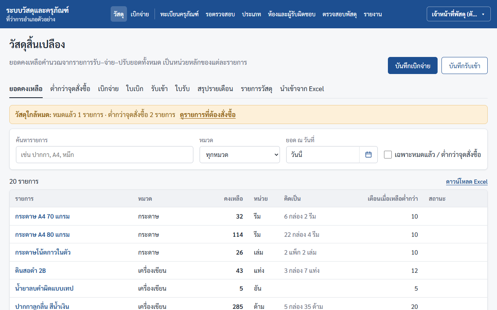
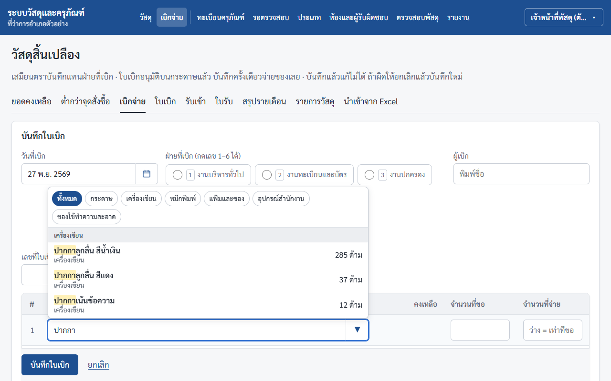
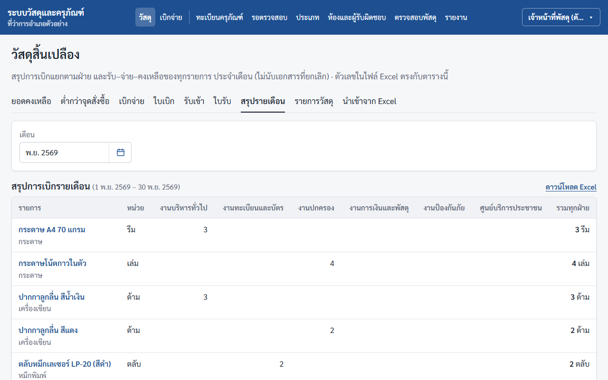
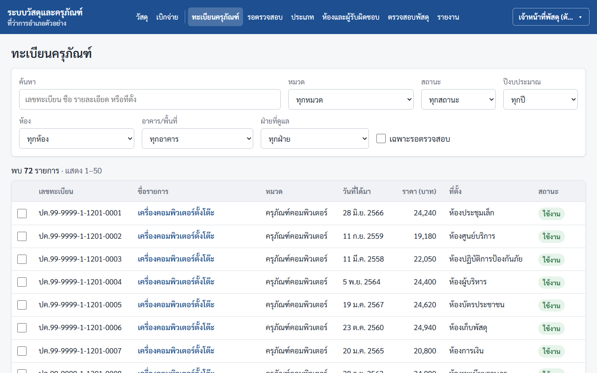
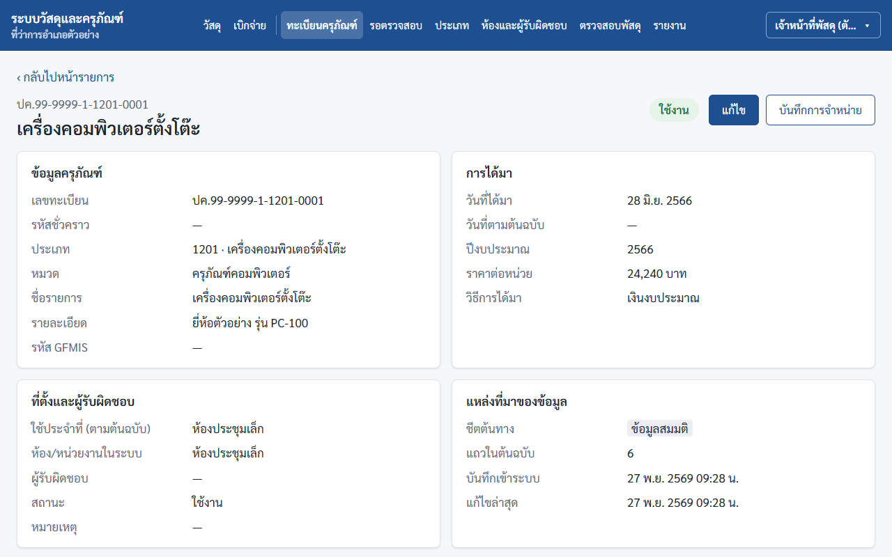
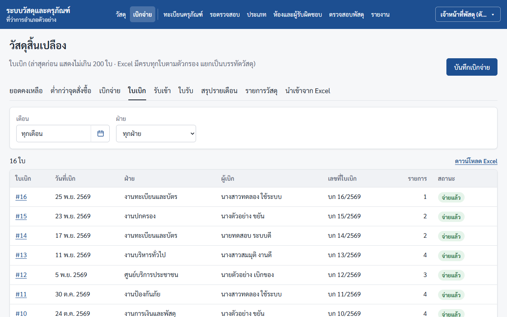
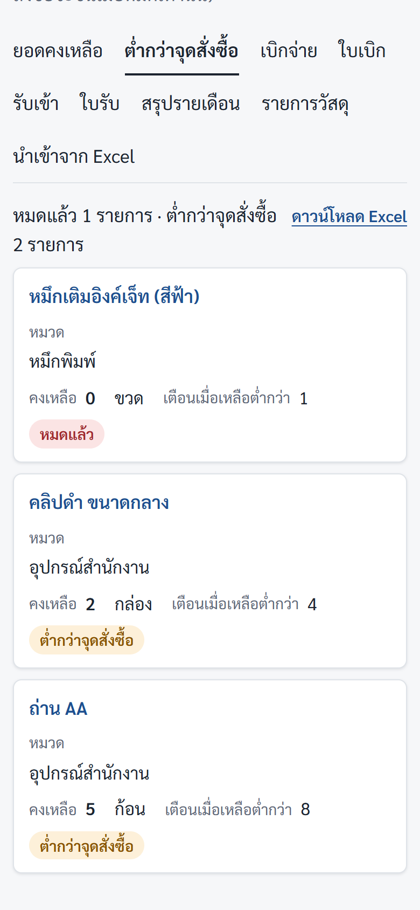

# ระบบวัสดุสิ้นเปลืองและทะเบียนครุภัณฑ์ (demo)

[English](README.en.md)

ระบบเว็บสำหรับงานพัสดุของที่ว่าการอำเภอ ใช้ในวงแลนของสำนักงาน เปิดได้ทั้งคอมพิวเตอร์และมือถือ
พัฒนาระหว่างการฝึกงานที่หน่วยงานราชการระดับอำเภอ

> **repo นี้เป็น demo ที่ใช้ข้อมูลสมมติทั้งหมด** ชื่อหน่วยงาน ("ที่ว่าการอำเภอตัวอย่าง") ชื่อคน ห้อง เลขทะเบียน
> (`ปค.99-9999-…`) ราคา และรายการวัสดุ สร้างขึ้นด้วย `scripts/seed_demo.py` ไม่มีข้อมูลจริงของหน่วยงานใด

## ระบบทำอะไร

**วัสดุสิ้นเปลือง** (งานหลัก)
- รายการวัสดุแยกหมวด หน่วยหลัก + หน่วยใหญ่ (เช่น 1 กล่อง = 5 รีม) จุดสั่งซื้อ
- บันทึกรับเข้าและเบิกจ่าย แยกตามฝ่าย พร้อมผู้อนุมัติ จ่ายได้ไม่เกินยอดที่มี ยกเลิกเอกสารได้โดยไม่ลบประวัติ
- ยอดคงเหลือคำนวณจากรายการเคลื่อนไหวเสมอ (ไม่มีช่องยอดที่แก้ตรงได้ ยอดห้ามติดลบ) ดูย้อนหลัง ณ วันที่ใดก็ได้
- เตือนรายการที่หมดหรือต่ำกว่าจุดสั่งซื้อ บัญชีวัสดุรายรายการ
- สรุปรายเดือน: การเบิกแยกตามฝ่าย และรับ–จ่าย–คงเหลือ
- ส่งออก Excel ทุกตาราง (ฟอนต์ไทย วันที่ พ.ศ. หน้ากระดาษ A4) และนำเข้ารายการวัสดุจาก Excel พร้อมหน้าตรวจก่อนบันทึก
- ช่องเลือกวัสดุค้นหาได้แม้พิมพ์ผิด (วรรณยุกต์ ตัวสะกดใกล้เคียง หลายคำสลับลำดับ)
- ช่องวันที่และปฏิทินแบบ พ.ศ. ของระบบเอง: พิมพ์ 27/11/2569 หรือเลขไทยได้ พิมพ์ปี ค.ศ. แปลงให้ ปีผิดบันทึกไม่ได้ ใช้คีย์บอร์ดได้ครบ

**ทะเบียนครุภัณฑ์**
- ทะเบียนตามเลขครุภัณฑ์ ค้นหาและกรองตามหมวด สถานะ ปีงบประมาณ ห้อง อาคาร ฝ่าย
- ห้องและผู้รับผิดชอบ ประวัติการย้าย ประวัติซ่อม การจำหน่าย รายการที่ต้องตรวจสอบ
- รอบตรวจสอบพัสดุประจำปี และรายงานพิมพ์รูปแบบเดียวกับแบบฟอร์มราชการ

**ทั้งระบบ**
- ผู้ใช้ 3 ระดับ (admin / editor / viewer) และบันทึกทุกการแก้ไข/ส่งออกใน audit log
- ตัวกรองทุกหน้ากรองทันทีเมื่อเปลี่ยนค่า URL ตามตัวกรอง (กดย้อนกลับได้) และยังใช้ได้เมื่อปิด JavaScript
- รองรับจอมือถือ: ตารางเปลี่ยนเป็นการ์ดบนจอแคบ

## ภาพหน้าจอ (ข้อมูลสมมติ)

<table>
  <tr>
    <td width="50%"><br>ยอดคงเหลือวัสดุ</td>
    <td width="50%"><br>บันทึกเบิกจ่าย (ช่องค้นหาวัสดุ)</td>
  </tr>
  <tr>
    <td width="50%"><br>สรุปการเบิกรายเดือน</td>
    <td width="50%"><br>ทะเบียนครุภัณฑ์</td>
  </tr>
  <tr>
    <td width="50%"><br>รายละเอียดครุภัณฑ์</td>
    <td width="50%"><br>รายการใบเบิก (กรองตามเดือน/ฝ่าย)</td>
  </tr>
</table>

**บนมือถือ:** ตารางเปลี่ยนเป็นการ์ด (วัสดุต่ำกว่าจุดสั่งซื้อ)



## เทคโนโลยี

- Python 3.12, [FastAPI](https://fastapi.tiangolo.com/), Jinja2, [htmx](https://htmx.org/), SQLite
- ไม่มี build tool และไม่ใช้ framework ฝั่ง JavaScript: CSS/JS เขียนเองทั้งหมด ไฟล์ static ทุกไฟล์อยู่ในเครื่อง (ไม่โหลดจาก CDN)
  เพราะเครื่องในสำนักงานอาจไม่มีอินเทอร์เน็ต
- openpyxl (Excel), argon2 (รหัสผ่าน), session แบบ signed cookie + CSRF token
- pytest และ Playwright (ทดสอบในเบราว์เซอร์จริง) และสคริปต์ตรวจหน้าตาทุกหน้าที่ความกว้าง 390–1920px (`tests/ui_audit.py`)
- ฟอนต์ Sarabun และ TH Sarabun New (ดูหัวข้อ License)

## ติดตั้งและรัน demo

ต้องมี [uv](https://docs.astral.sh/uv/) (uv ติดตั้ง Python 3.12 ให้เองถ้ายังไม่มี)

```
git clone <url ของ repo นี้>
cd krupan-demo
uv sync
uv run python scripts/seed_demo.py
uv run uvicorn app.main:app --port 8000 --no-server-header
```

เปิด http://127.0.0.1:8000 แล้วเข้าสู่ระบบด้วยบัญชี demo

- `seed_demo.py` สร้างไฟล์ `.env` พร้อม `KRUPAN_SECRET_KEY` ที่สุ่มใหม่ และฐานข้อมูล `data/krupan.db` ที่มีข้อมูลสมมติ
- สร้างข้อมูลใหม่ทั้งหมด: `uv run python scripts/seed_demo.py --reset`

### บัญชี demo

| ชื่อผู้ใช้ | รหัสผ่าน | สิทธิ์ |
|---|---|---|
| `admin` | `demo-admin-2569` | ผู้ดูแลระบบ (ตั้งค่า ผู้ใช้ สำรองข้อมูล) |
| `editor` | `demo-editor-2569` | บันทึกรับ–จ่าย แก้ไขครุภัณฑ์ |
| `viewer` | `demo-viewer-2569` | ดูและส่งออกรายงานอย่างเดียว |

> **คำเตือน:** รหัสผ่านข้างบนเปิดเผยอยู่ใน README สาธารณะ ใช้กับข้อมูลสมมติใน demo เท่านั้น
> ถ้าจะใช้ระบบกับข้อมูลจริงหรือเปิดให้คนอื่นเข้า ต้องเปลี่ยนรหัสผ่านทุกบัญชีก่อน
> หรือสร้างข้อมูลด้วย `uv run python scripts/seed_demo.py --reset --production` ซึ่งบังคับให้ทุกบัญชีเปลี่ยนรหัสผ่านตอนล็อกอินครั้งแรก

### ข้อมูลสมมติที่สร้าง

- ครุภัณฑ์ 72 ชิ้น 6 หมวด ใน 11 ห้อง 3 อาคาร 6 ฝ่าย (บางชิ้นไม่ทราบราคา บางชิ้นยังไม่มีเลขทะเบียน)
- วัสดุ 20 รายการ 6 หมวด ยอดยกมา ใบรับ/ใบเบิกย้อนหลังประมาณ 3 เดือน (มีตัวอย่างใบที่ยกเลิก และรายการที่หมด/ใกล้หมด)

## ทดสอบ

```
uv run --with playwright pytest
uv run --with playwright python tests/ui_audit.py
```

test ในเบราว์เซอร์ใช้ Microsoft Edge (`channel="msedge"`) ถ้าไม่มี playwright ชุด test ในเบราว์เซอร์จะถูกข้าม

## โครงสร้าง

```
app/            โค้ดเว็บ (routers/ หน้าจอ, templates/ Jinja2, static/ CSS JS ฟอนต์)
docs/schema.sql โครงสร้างฐานข้อมูล
scripts/        seed_demo.py (ข้อมูลสมมติ), init_db.py, create_user.py, backup.py ฯลฯ
tests/          pytest + Playwright
```

## License

โค้ดใช้ [MIT License](LICENSE)

ฟอนต์ใน `app/static/fonts/` ไม่อยู่ใต้ MIT แต่ใช้ license ของฟอนต์เอง ดู [app/static/fonts/README.md](app/static/fonts/README.md)
- Sarabun: SIL Open Font License 1.1 ([OFL.txt](app/static/fonts/OFL.txt))
- TH Sarabun New: [THSarabunNew-LICENSE.txt](app/static/fonts/THSarabunNew-LICENSE.txt)
